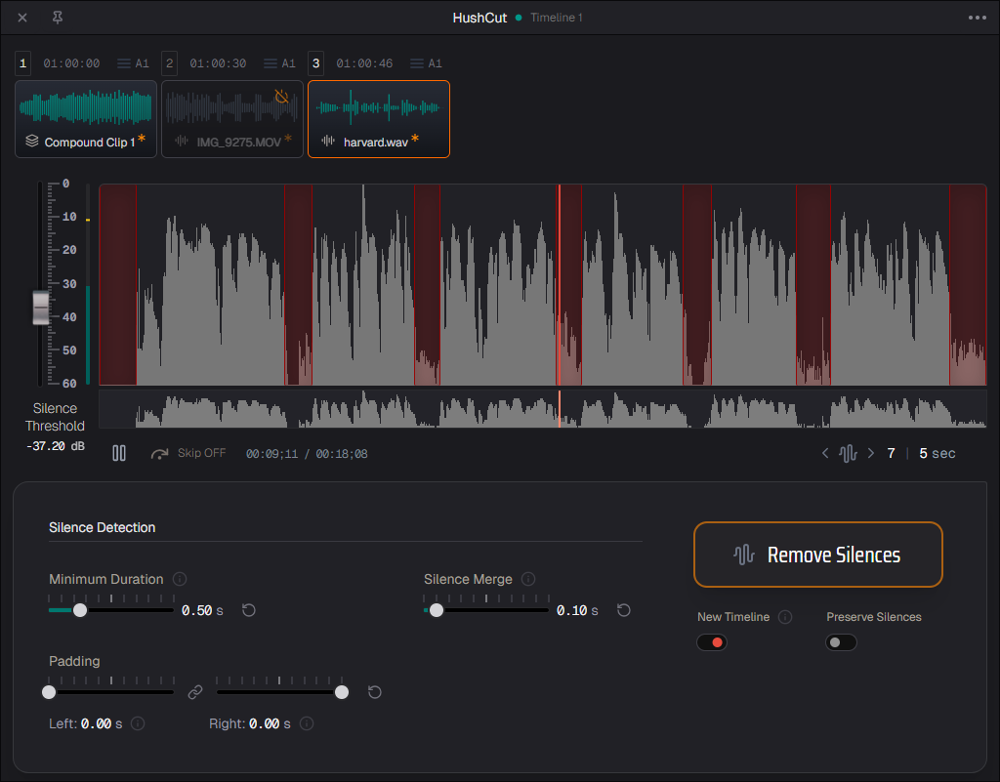

# HushCut - A DaVinci Resolve Plugin
Remove Silences from Videos, Compound Clips, Multicam Clips at Lightspeed!

Important: This app is still in development. The windows binaries haven't been signed, meaning you will most likely get a security warning! (MacOS and Linux are fine)

- Download from gumroad: [gethushcut.com](https://gethushcut.com)

- [Buy me a coffee!](http://buymeacoffee.com/hushcut)


### Seamless DaVinci Resolve Integration
* No need to import XML files back and forth: HushCut integrates seamlessly into DaVinci Resolve.
* It's a standalone application compatible with both the Studio as well as the Free version of Resolve (free users launch via a Lua script). Only DaVinci Resolve and FFmpeg (automatically downloaded) are required.

### Interactive GUI with Live Preview
Edit audio with an interactive GUI and live waveform preview.
Five intuitive controls (silence threshold, minimum duration, left/right padding, silence merge) let you precisely detect and remove silences, from quick cuts to professional polish.

### It's Fast!

How fast? Really fast! The benchmarks speak for themselves.

Test System:
- Intel® Core™ i7-6700K × 8
- NVIDIA GeForce GTX 1070
- 32 GB RAM

Results on a 16-minute, 4K QuickTime (H.264) file:

* **Pre-processing (WAV conversion)**: 0.53 seconds. This is a one-time process per file, as the result is cached for 14 days.
Silence Detection: Virtually instantaneous, updating in real-time as you adjust the sliders.

* **Making the Cuts**: Removing 105 detected silences took just 1.52 seconds. That's only 14 milliseconds per edit!

**Time Saved**
In this example, what would take an editor roughly 5-7 minutes of tedious manual cutting is done in 2 seconds. You can realistically expect a 10x or greater productivity boost, especially on longer content.
The performance is so optimized that the main bottleneck is DaVinci Resolve's own scripting API. Rest assured, HushCut is engineered for maximum speed. It'll finish its work before you can take a sip of coffee.

### Who this is for

Video Editors & Content Creators who need to condense dialogue-heavy footage. YouTube Videos, Interviews, Tutorials, Podcasts, Shorts, Instagram Reels, TikToks, Memes, Compilations, etc.

Of course, it won't replace the art of a final, polished edit. As an editor myself, I built this tool to give me a solid starting point, while skipping over the boring work and letting me focus my energy on actually being creative. All in all I am certain that adding HushCut to your workflow will level up your editing game!


## Local development

### Prerequisites:
* Wails v3 CLI -> [install guide](https://v3.wails.io/quick-start/installation/)
* Go 1.23+
* Node.js & pnpm
* Python 3
* (Recommended) uv package manager -> [install guide](https://docs.astral.sh/uv/getting-started/installation/)

### Setup:
1. Build the Python backend:
   * **Linux & macOS:** `./build/scripts/buildPythonBackend.sh`
   * **Windows:** `.\build\scripts\win_buildPythonBackend.ps1`

2. Install frontend dependencies:
   ```bash
   cd frontend && pnpm install && cd ..
   ```

### Running Development Mode (Desktop)

Run in the project directory:
```bash
wails3 dev
```
This starts the Vite dev server with hot-reloading for the frontend, compiles the native desktop application, and launches the desktop window.

> **Developer Tools:** Open with <kbd>Cmd</kbd>+<kbd>Option</kbd>+<kbd>I</kbd> / <kbd>F12</kbd>, or right-click anywhere in the app and select **Open Developer Tools**.

### Running in Browser Mode

Wails v3 provides two ways to run in an external browser:

#### 1. Fast UI Preview (Vite)
While `wails3 dev` is running, open `http://localhost:9245` in any web browser.
* Fast hot-reloading for UI and layout adjustments.
* Runs in Preview Mode with mocked backend responses so no console 404s appear.

#### 2. Full Browser Server Mode (Live Go Backend)
To run HushCut as a web server with full access to the live Go backend, service bindings, and WebSocket events in your browser (without opening a native desktop GUI window), run with the `server` build tag:

```bash
go run -tags server .
```
Then navigate to **`http://localhost:8080`** in Chrome, Safari, or Firefox.

You can customize the host and port via environment variables:
```bash
WAILS_SERVER_PORT=8080 WAILS_SERVER_HOST=127.0.0.1 go run -tags server .
```

### Building for Production

To build a redistributable package for your current OS:
```bash
wails3 task package
```
* **macOS:** Creates signed `.app` in `bin/`
* **Windows:** Creates executable in `bin/`
* **Linux:** Creates binary in `bin/`

